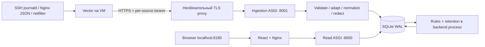

# Архитектура AttackScope v0.1

Реализована локальная MVP архитектура. Реальные VM не подключались; статус
проверок и ограничения приведены в RELEASE_0_1.md и ROADMAP.md.

Два основных контейнера: backend (Python3.12/FastAPI/SQLAlchemy/Alembic/SQLite)
и frontend (React/TypeScript/Vite build, Nginx runtime). Никаких Redis/Celery,
отдельной DB-службы или microservices. Один process владеет двумя Uvicorn
listeners и фоновым циклом: process_pending каждые2s, cleanup раз в минуту.
Общий lifecycle завершает оба listener при ошибке/stop; migrations до старта.
Read routes физически отсутствуют в ingestion app и наоборот.

Default Compose публикует только 127.0.0.1:8180. Backend bind0.0.0.0 внутри
Docker network, порты не published. Nginx proxy имеет read-path allowlist;
Host/Origin ограничены local UI. Это один доверенный оператор, multi-user auth
не реализован. TLS profile оператора отдельно добавляет только ingress8443.
Vector на Linux предпочтительно non-root системный сервис с чтением нужных logs.

## Данные и транзакции

SQLite local named volume /data (не NFS/SMB), patched WAL runtime, FK, FULL sync,
bounded pool/SQL deadlines. Event/delivery key/pending/hourly counters сохраняются
атомарно; response2xx — после commit. Host/kind из source identity. Повторная
доставка не создаёт вторую запись/counter. Raw журналы не пишутся в DB: safe
projection allowlist. HTTP query values/headers/cookie/body отбрасываются.

Классификатор читает durable pending, группирует по rule/host/IP/fixed UTC window,
upsert-ит explainable finding и помечает события в одной write transaction.
Window watermark LRU4096 — только оптимизация после commit, не источник истины.
Restart оставляет очередь в DB; late events имеют новый received_at и пересчёт.
Findings — отдельные ромбы на Timeline, raw observations — кружки.

Detail TTL30d, hourly rollups/findings365d, delivery keys30d. Cleanup маленькими
транзакциями, без вычитания rollup counts. Старые detail queries сразу получают410.
Историческая страница читает только полные UTC часы с явной coverage; URL/status
после detail retention недоступны. См. DATA_MODEL.md и RETENTION.md.

## Timeline и queries

Сервер отдаёт до min(1500,target_buckets*3) отдельных events или точные временные
source/category groups. target_buckets20..500, default60, UI выбирает размер по
экрану. Zoom/pan debounced повторно запрашивают API, raw month не грузится.
Фильтры AND: range/host/IP/source/category/destination port/severity.
Events используют keyset(timestamp,id), received-at watermark и15m cursor.
Overview cache10s/32 keys; distributions top100 и findings500 имеют явный truncated.
Экспорт bounded10000 events/8MiB, atomic response, CSV formula escaping.

## Границы модулей

- api: ASGI routes, limits, bounded queries, timeline/analytics/history/export.
- normalization: schema1, safe fields, SSH/netfilter adapters; source extension
  добавляет новый typed envelope/adapter и тесты, storage core остаётся общим.
- classification: детерминированные правила с config snapshot/evidence/version.
- enrichment: Protocol и unavailable provider; GeoIP/ASN не выдумываются.
- storage: schema/migrations, transactions, source auth, batch persistence/retention.
- frontend/features: Timeline, IPExplorer, Overview, EventExplorer, History/details.
- deploy: Dockerfiles, Compose, optional TLS, Vector/Nginx/firewall examples.

Иные источники (CrowdSec/WAF/Suricata) и enrichment допускаются этими границами,
но не реализованы. Vector примеры используют bounded memory buffer: crash агента
может потерять очередь; raw journald disk buffer не создаётся. Не меняются VM,
SSH/firewall пользователя, нет автоблокировки/LLM/системных метрик.
