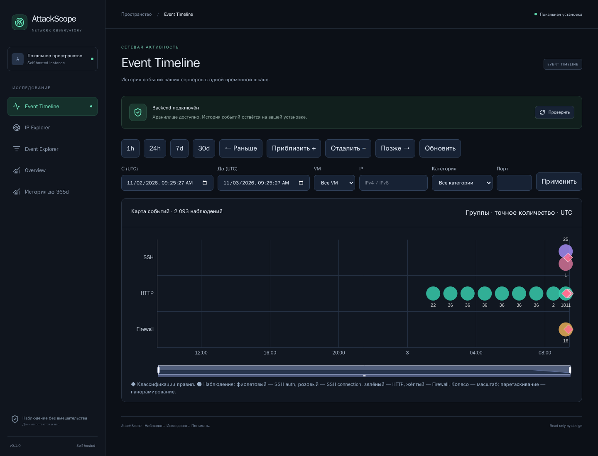

# AttackScope v0.1 — руководство пользователя

Это вход в подробную вики AttackScope: от первого открытия Timeline до проверки
подозрительной активности, экспорта и обслуживания собственной установки.
Названия кнопок соответствуют текущему интерфейсу. Документация — на русском;
названия экранов, полей API и правил сохранены на английском.

**Начать чтение:** [главная страница вики](wiki/README.md).

*Рисунок 1. Настоящий интерфейс на синтетических данных. Числа относятся к учебному
стенду; это не статистика рабочей VM. На изображениях только демонстрационные IP.*

## Содержание

| Раздел | На какой вопрос отвечает |
|---|---|
| [Первый запуск и навигация](wiki/01-quickstart.md) | Куда открыть приложение и что проверить сначала? |
| [Event Timeline](wiki/02-timeline.md) | Когда возникла активность и как приблизить нужный участок? |
| [Event Explorer и экспорт](wiki/03-events.md) | Какие конкретно записи сохранены и как выгрузить их? |
| [IP Explorer](wiki/04-ip-explorer.md) | Что делал выбранный IP и к каким ресурсам обращался? |
| [Overview и история](wiki/05-overview-history.md) | Сколько было наблюдений и что осталось после удаления деталей? |
| [Классификация и смысл событий](wiki/06-detection.md) | Почему появилось срабатывание и что оно доказывает? |
| [Пошаговые расследования](wiki/07-investigations.md) | Как разобрать SSH-подбор, web scanning и поиск секретов? |
| [Установка и эксплуатация](wiki/08-operations.md) | Как подключать источники, обновлять и делать backup? |
| [Диагностика проблем](wiki/09-troubleshooting.md) | Что делать при пустом экране, ошибке API или расхождении чисел? |
| [Поля, термины и ограничения](wiki/10-reference.md) | Что означают timestamp, severity, source_reference и другие поля? |
| [Обновление скриншотов](wiki/11-screenshots.md) | Как воспроизвести учебный стенд и переснять документацию? |

## Что показывает AttackScope

AttackScope сохраняет **наблюдения из подключённых журналов**. Например:

- SSH сообщил о неуспешном или успешном входе;
- Nginx записал HTTP-запрос к определённому пути;
- firewall записал пакет, если для него было включено логирование.

Детерминированные правила ищут известные признаки: много SSH-ошибок с одного IP,
частые HTTP-запросы, перебор URL, обращения к чувствительным путям и наблюдаемые
обращения к разным портам. Их результаты называются **findings**, или
**срабатываниями классификации**.

Событие и finding — разные сущности. Успешный SSH-вход администратора является
событием, но сам по себе не считается атакой. Запрос `/.aws/credentials` является
наблюдением поиска известного пути; срабатывание не устанавливает, что сервер
отдал содержимое файла.

## Быстрый маршрут на 15 минут

1. Откройте свою установку и проверьте надпись **«Backend подключён»**.
2. На Timeline выберите **24h** и нужную VM.
3. Найдите плотную группу или ромб классификации; приблизьте участок.
4. Откройте событие и прочитайте IP, время, порт, тип и безопасные атрибуты.
5. Перейдите по **«История IP»** и сравните пути, статусы, SSH outcomes и правила.
6. В Event Explorer уточните фильтры и выгрузите небольшой диапазон в JSON.
7. Сформулируйте вывод отдельно от фактов: что наблюдалось, почему это
   подозрительно, чего имеющиеся журналы не подтверждают.

Полный учебный разбор — в [сценариях расследований](wiki/07-investigations.md).

## Три адреса, которые важно различать

| Адрес | Назначение примера |
|---|---|
| `http://localhost:8180` | Основная локальная установка, обычно с demo |
| `http://localhost:18180` | VM через настроенный оператором SSH-туннель |
| `http://localhost:18182` | Отдельный временный стенд для этой документации |

`localhost` относится к компьютеру, на котором открыт браузер. Для просмотра VM
должен работать соответствующий SSH-туннель. Наличие интерфейса на одном адресе
не означает, что остальные установки тоже запущены.

Стенд документации по умолчанию останавливается после съёмки. Чтобы пройти
учебные примеры с теми же IP и данными, запустите его с `--keep-running` по
[инструкции воспроизведения](wiki/11-screenshots.md).

## Как читать изображения

Все 12 изображений сняты Chromium с настоящего React-приложения. Набор включает
SSH, HTTP, firewall, benign 404, cloud credential probes и помеченную операторскую
проверку. Эти события подготовлены специально для обучения; firewall-дорожка на
скриншоте не означает, что сбор firewall включён на рабочей VM.

Единственное смоделированное состояние API — ошибка HTTP503 на иллюстрации
диагностики. Она создана перехватом ответа в браузере и явно подписана.
Остальные экраны используют API отдельного demo-backend.
Происхождение и контрольные суммы: [manifest.json](images/manifest.json).

## Правила интерпретации

- **Нет событий** — нет сохранённых наблюдений по текущим фильтрам. Это не
  доказательство отсутствия сетевого трафика.
- **404** — ответ «не найдено», а не автоматическое доказательство атаки.
- **200 на `/login`** — успешная выдача HTTP-ответа, а не подтверждение входа.
- **307** — перенаправление, а не подтверждение чтения секрета.
- **SSH success** — успешная SSH-аутентификация; её ожидаемость оценивает оператор.
- **«Возможная проверка оператора»** — подсказка по подделываемому User-Agent.
  Событие продолжает учитываться в правилах и статистике.
- **IP** характеризует наблюдаемый сетевой источник. Он не устанавливает личность
  человека и может принадлежать NAT, proxy, VPN или общей инфраструктуре.

Подробные границы выводов разобраны в [классификации](wiki/06-detection.md).

## Для администратора и разработчика

Для пользовательской работы начинайте с вики. Для технической настройки:
[установка](INSTALLATION.md), [сбор](COLLECTION.md), [ingestion и токены](INGESTION.md),
[модель данных](DATA_MODEL.md), [API](API.md), [архитектура](ARCHITECTURE.md).

Пример компоновки VM описан отдельно в [PRODUCTION.md](PRODUCTION.md).
Процедура локального обновления frontend — в [DEPLOYMENT.md](DEPLOYMENT.md).
Не переносите команды конкретной рабочей установки на другой сервер без проверки
каталогов, проекта Compose, владельцев файлов и версии приложения.
