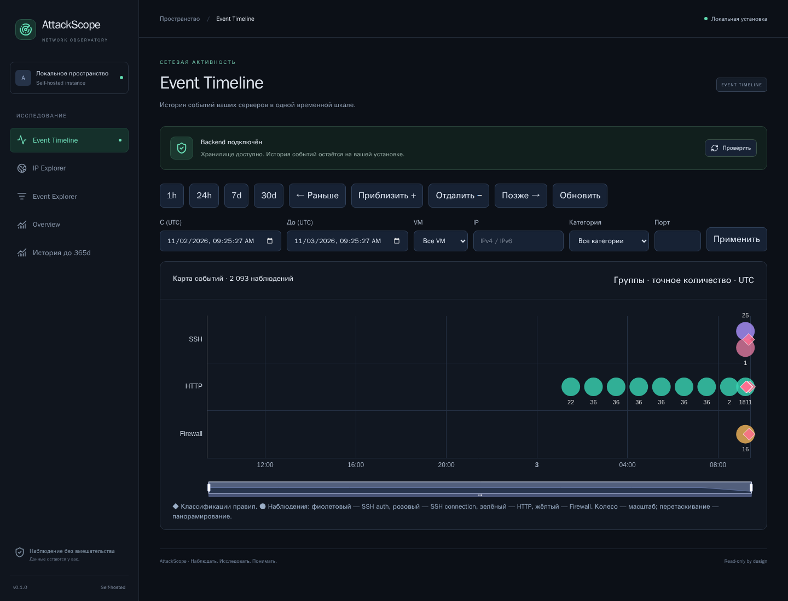
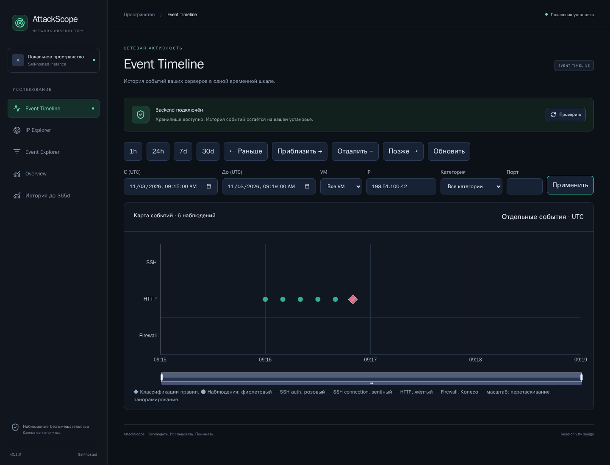
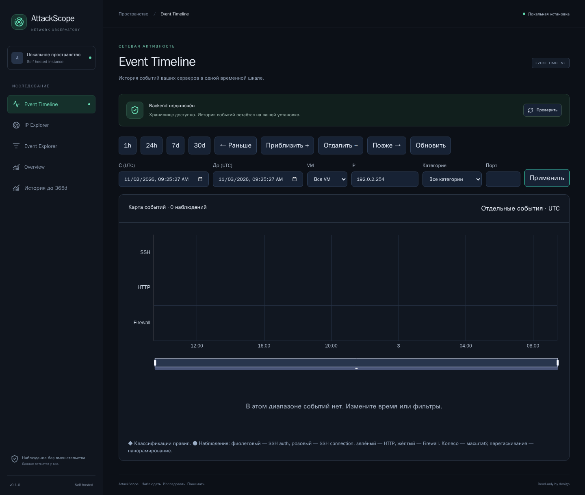

# 02. Event Timeline

[Вики](README.md) · [Назад: первый запуск](01-quickstart.md) · [Далее: события](03-events.md)

Timeline — основной экран исследования. Он отвечает на вопросы: **когда** появилась
активность, **какого источника**, насколько она плотная и с каких наблюдений
стоит начать разбор.

*Учебный набор. Круги с числами — группы наблюдений; ромбы — результаты правил.*

## Из чего состоит экран

1. Панель интервалов, перемещения и масштаба.
2. Форма времени и фильтров.
3. Заголовок с количеством наблюдений по текущему запросу.
4. Временная карта с тремя дорожками.
5. Легенда и карточка выбранного элемента, если он открыт.

Горизонтальная ось — время UTC. Вертикальные дорожки — **SSH**, **HTTP**, **Firewall**.
Дорожки не являются списком всех открытых портов или всех работающих служб VM.

## Цвета и символы

| Обозначение | Что означает |
|---|---|
| Фиолетовый круг | SSH authentication |
| Розовый круг | SSH connection/disconnect |
| Зелёный круг | HTTP request |
| Жёлтый круг | Firewall observation |
| Ромб с контрастной окантовкой | Finding: результат детерминированного правила |
| Число у группы | Фактическое количество событий в её временной ячейке |

Цвет круга указывает категорию, а не тяжесть инцидента. Зелёный HTTP-круг может
содержать подозрительный запрос, а фиолетовый SSH-круг — штатный вход.
Severity смотрите в карточке события.

Ромб не добавляет ещё один входящий запрос. Он ссылается на уже сохранённые
события и объясняет, почему правило объединило их в срабатывание.

## Группы и отдельные события

При большом количестве записей backend возвращает агрегаты по времени,
источнику и категории. Браузер получает ограниченный набор групп вместо всех
событий за месяц. Числа групп точные, не выборочные оценки.

Когда выбранный набор достаточно мал, API возвращает отдельные события.
Это зависит от количества записей и целевого числа временных ячеек, а не только
от ширины периода: шесть запросов за сутки могут отображаться отдельно;
1800 запросов в одном коротком всплеске останутся агрегированными.

Заголовок **«Карта событий · … наблюдений»** относится к текущим времени и фильтрам.
Он не равен числу нарисованных кругов и ромбов.
При перекрытии меток не все подписи помещаются на canvas; используйте tooltip
и детали группы для чтения конкретного количества.

## Выбор периода и масштаба

| Управление | Действие |
|---|---|
| 1h / 24h / 7d / 30d | Последний час / сутки / 7 / 30 дней |
| Приблизить + | Уменьшить длительность диапазона вдвое вокруг центра |
| Отдалить − | Увеличить диапазон вдвое вокруг центра, в пределах 30 дней |
| ← Раньше | Сдвинуть диапазон назад на половину его длительности |
| Позже → | Сдвинуть диапазон вперёд на половину длительности |
| Колесо над графиком | Изменить масштаб средствами графика |
| Нижний slider | Выделить более узкий участок времени |
| Перетаскивание графика | Перемещение внутри доступного масштаба |
| Обновить | Повторить запрос Timeline для текущих условий |

Для гарантированного перемещения за границы текущего участка используйте
**«Раньше / Позже»** или поля времени. Перетаскивание ограничено состоянием
масштаба графика; оно не является бесконечной прокруткой всей базы.

После изменения масштаба приложение запрашивает соответствующую детализацию
с сервера. Во время запроса прежняя карта остаётся видна с индикатором
**«Обновление событий…»**; затем обновляются данные и ось. Полная перезагрузка
документа не требуется. При медленном запросе не принимайте прежние точки за
уже полученный результат нового диапазона.

### Произвольный период

1. Заполните **«С (UTC)»** и **«До (UTC)»**.
2. Проверьте, что начало раньше окончания, длительность не больше 30 дней.
3. Нажмите **«Применить»**.

Интервалы API полуоткрытые: начало включено, конец исключён. Запись ровно
на правой границе относится к следующему диапазону. Детали старше retention
недоступны, даже если форма позволяет выбрать календарную дату.

## Фильтры

На снимке диапазон дополнительно сужен до четырёх минут вокруг серии запросов,
чтобы соседние точки можно было различить.

*Шесть учебных HTTP-запросов одного IP. Внешне спокойная карта может содержать
целенаправленный перебор известных конфигурационных путей.*

| Фильтр | Пример | Особенность |
|---|---|---|
| VM | demo-wiki | Host из зарегистрированных источников, не HTTP Host header |
| IP | 198.51.100.42 | Поиск конкретного source IP, поддерживается IPv6 |
| Категория | http_request | Тип наблюдения, а не ID правила |
| Порт | 443 | Известный destination port, не source port клиента |

Заполненные условия применяются совместно: VM **и** IP **и** категория **и** порт.
Чтобы убрать фильтр, очистите поле или выберите **«Все…»** и нажмите
**«Применить»**. Изменение текста в поле до отправки формы не меняет запрос.

Пример: выбрать VM → ввести `198.51.100.42` → категорию `http_request` → применить.
Поле IP не является строкой поиска по User-Agent, username или URL.

Неизвестный destination port хранится как `null`: фильтр по числу не покажет
такие события. Наличие SSH-события без dst_port не означает, что SSH работал
на стандартном порту 22.

## Открытие элемента

### Отдельное событие

Нажмите круг. Ниже откроется карточка с типом, временем, VM, IP, портом,
severity, атрибутами и безопасной проекцией исходных данных.
Ссылка **«История IP»** открывает IP Explorer с периодом карточки.

### Группа

Нажмите круг группы. В карточке будут источник, начало/конец и количество.
Нажмите **«Исследовать интервал»**, чтобы запросить её временной участок.
На очень плотной группе один drill-down всё ещё может вернуть агрегаты;
добавьте IP или другой фильтр, либо продолжите приближение.

### Классификация

Нажмите ромб. В карточке показаны правило и версия, окно UTC, фактическая
метрика, порог, причины и ссылки на исходные записи. Для sensitive_path v2
доступен список совпавших путей. Полный разбор — [в разделе правил](06-detection.md).

Несколько элементов могут находиться почти в одной точке: например, HTTP-запрос
и finding над ним. Если открылась карточка правила вместо группы, выберите
соседнюю точку или сузьте фильтр; это не дополнительный запрос к серверу.

## Пустой экран и ошибки

Пустой результат может означать неверный IP, непересекающийся период, слишком
узкую комбинацию фильтров или отсутствие подключённого источника. Сначала
очистите фильтры, выберите 24h/7d и проверьте host.

Ошибка API отображается отдельно; не трактуйте её как нулевое количество событий.
Полный порядок действий — [диагностика](09-troubleshooting.md).

## Что здесь не показывается

- Весь сетевой трафик без его журналирования.
- Пакеты, отброшенные firewall без соответствующего log event.
- Исторические URL после удаления детальных событий.
- Автоматическая оценка личности владельца IP или успешности эксплуатации.

**Далее:** [03. Event Explorer, карточка и экспорт](03-events.md).
