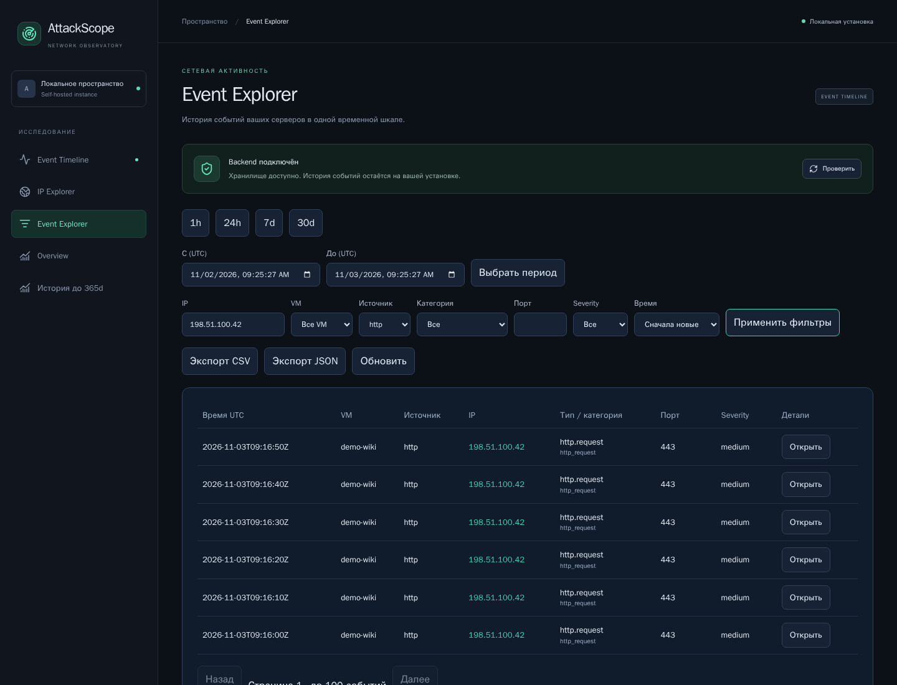
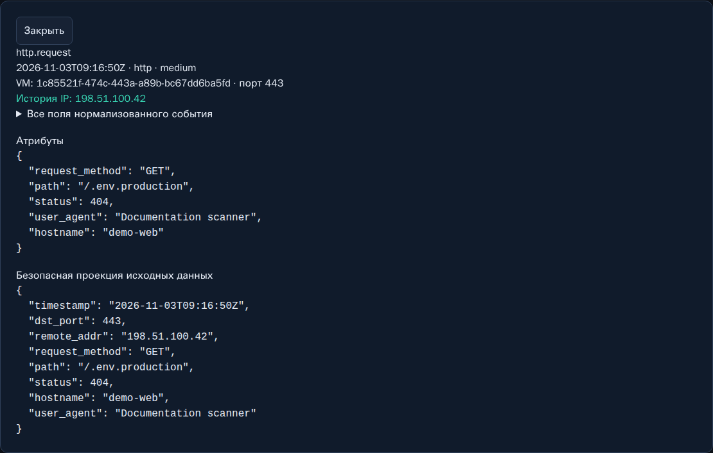
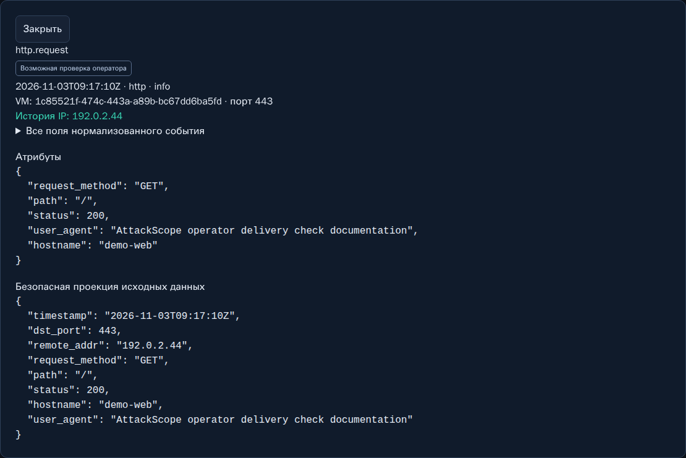

# 03. Event Explorer, карточки и экспорт

[Вики](README.md) · [Назад: Timeline](02-timeline.md) · [Далее: IP Explorer](04-ip-explorer.md)

Event Explorer предназначен для точной работы с сохранёнными записями:
выбрать период, отфильтровать источник, открыть поля и выгрузить результат.

## Фильтрация по шагам

1. Выберите предустановку периода либо укажите **«С / До (UTC)»** и нажмите
   **«Выбрать период»**.
2. В форме ниже заполните нужные поля.
3. Выберите порядок времени.
4. Нажмите **«Применить фильтры»**.
5. Проверьте строки и при необходимости откройте **«Детали → Открыть»**.

В отличие от Timeline здесь есть отдельные фильтры источника, severity и порядка.

| Поле | Допустимые значения / смысл |
|---|---|
| IP | Конкретный IPv4 или IPv6 source IP |
| VM | Зарегистрированный host |
| Источник | ssh, http, firewall |
| Категория | ssh_authentication, ssh_connection, http_request, firewall_packet |
| Порт | Destination port от 0 до 65535, если известен |
| Severity | info, low, medium, high |
| Время | Сначала новые или сначала старые |

Фильтры соединяются условием **И**. Например, severity=medium и source=ssh
не покажет обычный HTTP-probe. Для сброса очистите поля, выберите «Все» и
повторно примените форму.

В v0.1 нет отдельного поля поиска по URL, User-Agent или username. Найдите IP
через Timeline/IP Explorer, затем откройте его события и карточки.

## Колонки таблицы

- **Время UTC** — timestamp наблюдения, не момент получения сервером AttackScope.
- **VM** — имя host; если имя не найдено в загруженном списке, может отображаться ID.
- **Источник** — адаптер, принявший запись.
- **IP** — source IP и ссылка на его историю; `—` означает неизвестное значение.
- **Тип / категория** — конкретное событие и его общая категория.
- **Порт** — destination port; отсутствие не заполняется предположением.
- **Severity** — сохранённый уровень события.
- **Детали** — открытие безопасной карточки.

## Пагинация и обновление

На странице не более **100 записей**. **«Далее»** переходит к следующему cursor,
**«Назад»** — к сохранённой предыдущей странице. В UI цепочка ограничена;
для очень больших выборок используйте более узкие временные диапазоны.

Cursor действует 15 минут. Новые полученные события не вставляются посреди
начатой цепочки страниц. Это помогает последовательно просматривать выборку;
это не долгоживущий снимок всей базы, и связанные поля могут меняться при
классификации или retention.

**«Обновить»** возвращает к первой странице и делает новый запрос.
При истёкшем cursor обновите таблицу, а не пытайтесь продолжать старую цепочку.
Смена времени или фильтров также начинает просмотр сначала.

## Карточка события

В карточке доступны:

1. Тип, timestamp, source и severity.
2. Host ID и destination port.
3. Ссылка на историю IP, когда адрес известен.
4. Раскрываемые **«Все поля нормализованного события»**.
5. **«Атрибуты»** — поля, относящиеся к конкретному источнику.
6. **«Безопасная проекция исходных данных»** — разрешённые поля после очистки.

Проекция не является оригинальной строкой журнала. Из HTTP удаляются query
values; Authorization, Cookie и body не сохраняются. SSH MESSAGE заменяется
извлечёнными безопасными полями. Если значение отсутствует, карточка его
не восстанавливает и не выдумывает.

### Полезные поля по источникам

| Источник | На что смотреть |
|---|---|
| SSH | outcome, username при наличии, source IP/port, timestamp |
| HTTP | request_method, path, status, user_agent, duration_ms, hostname |
| Firewall | source/destination IP/port, protocol, action, interface при наличии |

`hostname` внутри HTTP-атрибутов и зарегистрированная VM — разные поля.
Первое пришло из producer; второе привязано к аутентифицированному источнику.

`path_truncated=true` означает, что producer обрезал путь до ограничения.
Не делайте вывод о полном исходном URL по обрезанной строке.

### Подозрительный текст в атрибутах

Строки вроде `<script>…` или `` показываются как текст. Они могут быть
попыткой атаки, тестовой строкой или частью произвольного User-Agent. Сам факт
наличия такой строки не доказывает исполнение JavaScript на целевом сайте.
Команды из журналов не являются инструкциями для запуска в терминале.

## Операторская пометка

**«Возможная проверка оператора»** означает совпадение User-Agent с известными
приёмочными префиксами AttackScope. Наведите курсор на пометку, чтобы прочитать
объяснение. Это не подтверждение автора запроса: User-Agent подделывается.

Пометка не меняет severity, не удаляет finding и не исключает запись из
Overview, Timeline, IP Explorer или экспорта. Она появляется и у старых
сохранённых событий с подходящим User-Agent, без пересчёта истории.
В JSON/CSV отдельного доверенного флага «это точно оператор» нет.

## Экспорт CSV и JSON

1. Убедитесь, что выбраны нужные время, IP, VM, source и severity.
2. Нажмите **«Экспорт CSV»** или **«Экспорт JSON»**.
3. Дождитесь **«Экспорт готов»** или прочитайте сообщение ошибки.
4. Сохраните файл вместе с описанием периода и фильтров.

Экспорт относится ко **всей отфильтрованной выборке**, а не только к текущей
странице из 100 строк. Применяется выбранный порядок сортировки.
Предел — **10 000 событий или 8 MiB**. Если превышен один из них, сервер
возвращает 413 до выдачи файла. Частичная незаметно обрезанная выгрузка не создаётся.
Разделите большой период на несколько непересекающихся интервалов.

CSV предназначен для таблиц: потенциально опасные начала ячеек экранируются
для защиты от formula injection. Внешний вид некоторых строк может содержать
ведущий апостроф — это ожидаемая защита, а не изменение исходного наблюдения.
JSON удобнее для структурированного анализа вложенных attributes.

Экспорт не содержит source tokens, но IP, пути, время и usernames могут
оставаться чувствительными. Перед публикацией отчёта подготовьте обезличенную
копию. Файл экспорта не является полной резервной копией приложения.

**Далее:** [04. История IP](04-ip-explorer.md).
