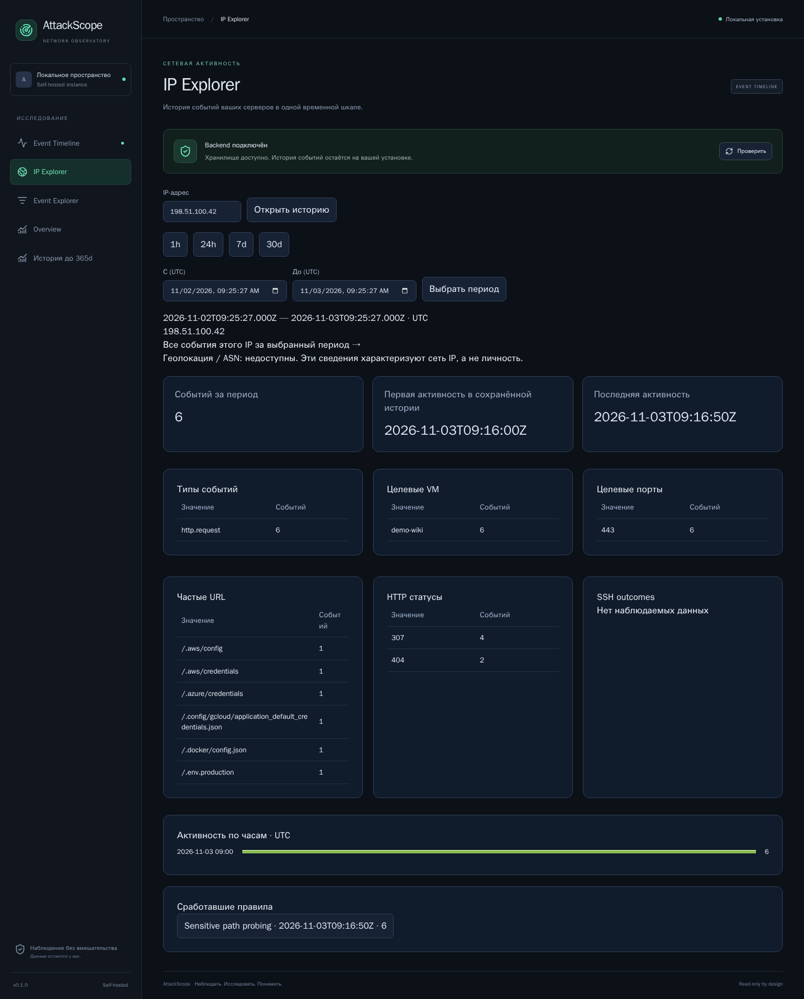
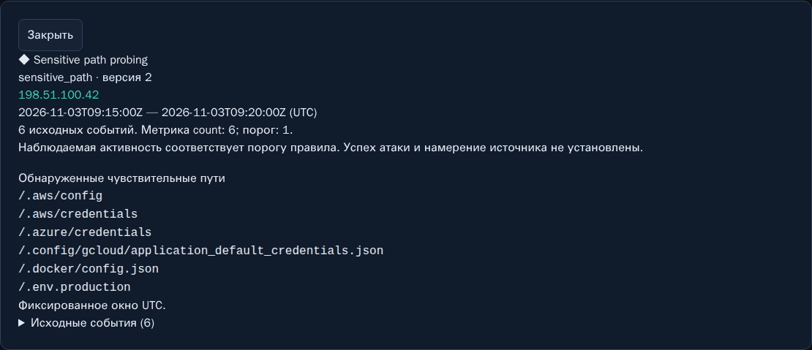

# 04. IP Explorer

[Вики](README.md) · [Назад: события](03-events.md) · [Далее: сводка и история](05-overview-history.md)

IP Explorer собирает наблюдения одного source IP: объём, распределения,
целевые VM, порты, HTTP-пути, статусы, SSH outcomes и срабатывания правил.

*В примере один демонстрационный адрес обращался к шести чувствительным путям.
Страница показывает наблюдения, а не биографию владельца IP.*

## Как открыть адрес

Есть три основных пути:

1. Открыть событие на Timeline и нажать **«История IP»**.
2. Нажать IP в таблице Event Explorer или в списке активных IP Overview.
3. Открыть **IP Explorer**, ввести IPv4/IPv6 и нажать **«Открыть историю»**.

Переход из карточки события передаёт её временной диапазон. Ручной ввод
адреса открывает адресную страницу; после перехода проверьте и при необходимости
задайте период снова. Не предполагайте, что все экраны автоматически разделяют
единый глобальный фильтр.

Адрес вводится целиком, без CIDR-маски, порта и URL. Для IPv6 используйте сам адрес,
например `2001:db8::bad`, без `http://` и квадратных скобок.

## Период и первые/последние наблюдения

Кнопки 1h/24h/7d/30d и произвольный диапазон относятся к детальной истории.
Верхняя строка явно показывает фактические выбранные timestamps UTC.

**«Событий за период»** — записи в текущем диапазоне.
**«Первая активность в сохранённой истории»** и **«Последняя активность»**
основаны на доступных сохранённых агрегатах адреса и могут выходить за этот
диапазон. Они не означают первый или последний контакт за всё время жизни VM.

Если сервер наблюдается только несколько часов, приложение не знает, что
происходило вчера до подключения коллектора. После retention ранняя история
также ограничена сохранёнными данными.

## Распределения

| Блок | Как использовать |
|---|---|
| Типы событий | Отличить HTTP, SSH success/failure и firewall observation |
| Целевые VM | Понять, обращался ли IP к одному или нескольким подключённым host |
| Целевые порты | Сравнить наблюдаемые назначения; null не превращается в порт 0 |
| Частые URL | Увидеть повтор одного пути или перебор разных ресурсов |
| HTTP статусы | Проверить ответы без предположения о результате авторизации |
| SSH outcomes | Разделить success, failure, invalid_user и disconnect |
| Активность по часам | Найти временную концентрацию наблюдений |

Распределения содержат top 100 значений. Если список сокращён, UI сообщает
об этом. Сумма видимой top-таблицы не обязана совпадать с общим числом событий:
может быть обрезка, неизвестные значения или другая область применимости поля.

Например, для SSH-источника таблица URL закономерно пустая. Для HTTP без известного
порта часть событий не попадёт в распределение портов.

## Сработавшие правила

Ниже статистики находится блок **«Сработавшие правила»**. Нажмите кнопку нужного
finding, чтобы открыть правило, версию, окно, count/threshold, matched paths
при наличии и evidence IDs.

В учебном примере sensitive_path v2 объединил шесть обращений одного IP
к конфигурациям и credentials в одном фиксированном окне. Это не шесть
подтверждённых утечек. Статусы 307/404 не подтверждают выдачу файлов.

Если finding ссылается на старое событие, детальная запись уже могла истечь.
Срабатывание хранится дольше деталей; недоступная evidence-карточка не означает,
что finding выдуман или что журналы обязательно были удалены атакующим.

## Переход ко всем событиям

Ссылка **«Все события этого IP за выбранный период →»** открывает Event Explorer
с IP и временем. Используйте её, чтобы проверить порядок записей, открыть
безопасные атрибуты и экспортировать историю адреса.

После перехода проверьте дополнительные фильтры таблицы. Фильтр source=ssh
не покажет HTTP-активность того же IP, хотя IP Explorer объединяет источники.

## GeoIP и ASN

Без установленного enrichment provider интерфейс показывает
**«Геолокация / ASN: недоступны»**. Это ожидаемое поведение v0.1; приложение
не подставляет страну по догадке и не обращается автоматически к внешнему lookup.

Даже при будущем enrichment геоданные будут характеризовать сетевую
инфраструктуру IP, а не гражданство, местоположение или личность человека.
Один IP может обслуживать множество пользователей; User-Agent также не
доказывает используемый человеком браузер.

## Как сформулировать вывод

Хорошо: «За выбранный период с IP зарегистрировано шесть GET к известным
конфигурационным путям; ответы 307/404, sensitive_path v2, факт выдачи секретов
журналами не подтверждён».

Недостаточно обоснованно: «Этот человек украл AWS-ключи», если имеются только
IP, путь и HTTP status.

**Далее:** [05. Overview и исторические агрегаты](05-overview-history.md).
