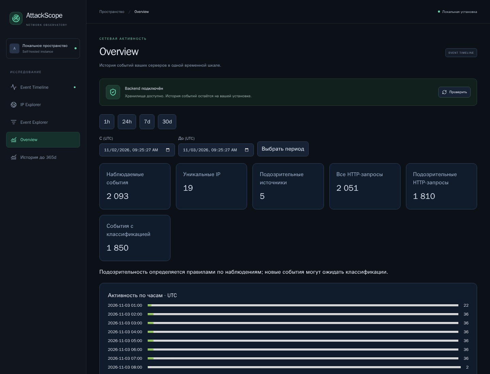
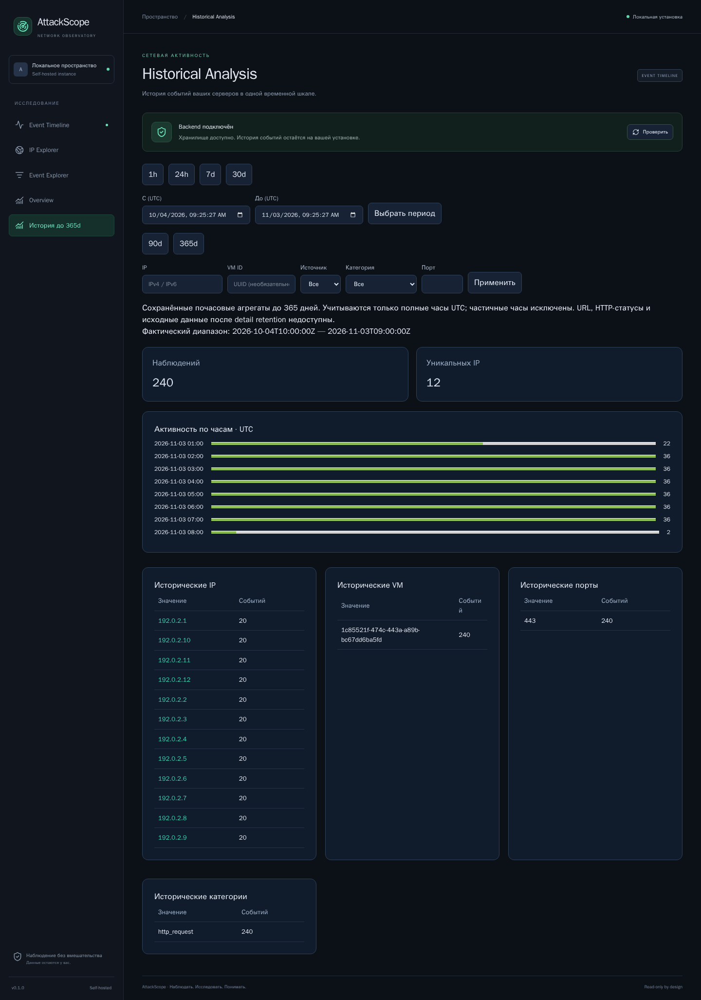

# 05. Overview и исторические агрегаты

[Вики](README.md) · [Назад: IP Explorer](04-ip-explorer.md) · [Далее: классификация](06-detection.md)

Эти экраны отвечают на разные вопросы. **Overview** описывает выбранный период
детальных наблюдений. **История до 365d** показывает сохранённые временные
агрегаты, включая периоды, для которых отдельные события уже истекли.

## Overview

Сначала выберите период. Поля произвольного времени — UTC, максимальный
детальный диапазон по умолчанию 30 дней.

### Верхние показатели

| Показатель | Определение | Чего из него не следует |
|---|---|---|
| Наблюдаемые события | Все сохранённые события в периоде | Это не весь трафик VM |
| Уникальные IP | Различные известные source IP | Это не число людей |
| Подозрительные источники | IP с событиями, отмеченными правилами | Это не подтверждённые злоумышленники |
| Все HTTP-запросы | HTTP-события подключённых журналов | Это не только атаки |
| Подозрительные HTTP-запросы | HTTP-события с классификацией | Это не успешные эксплуатации |
| События с классификацией | Отмеченные правилами события всех источников | Это не число findings |

Общая HTTP-активность и подозрительная HTTP-активность разделены намеренно.
Не складывайте их: подозрительные запросы уже входят в общий HTTP-count.
Аналогично события с классификацией входят в общий объём наблюдений.

Пример: 100 HTTP-событий, из которых 8 классифицированы, означают 100 общих
запросов и 8 подозрительных, а не 108 запросов.

Одна запись может соответствовать нескольким правилам. Список findings и
метрика событий поэтому имеют разные единицы. Raw classification события
содержит последнее совпадение; все findings доступны отдельно.

### Остальные блоки

- **Активность по часам · UTC** — когда поступали наблюдаемые события.
- **События по категориям** — соотношение SSH auth/connection, HTTP и firewall.
- **Активные IP** — источники с наибольшим количеством записей; IP открывает историю.
- **Частые пути** — наиболее частые сохранённые HTTP paths.
- **Целевые порты** — известные destination ports.

Полосы активности используют относительный максимум выбранных данных. Они
не показывают процент загрузки CPU, пропускную способность канала или DDoS
нагрузку на сетевом интерфейсе.

### Почему цифры могут измениться после загрузки

Классификатор работает асинхронно. Событие уже может быть видно, пока finding
ещё обрабатывается. После небольшого ожидания повторите запрос или обновите
страницу. Это не обещание мгновенной классификации при произвольной нагрузке.

Overview не является непрерывно растущим live-счётчиком. Для нового периода
выберите предустановку заново; другие страницы имеют собственные состояния
диапазона и обновления.

## История до 365d

Экран использует hourly rollups. Доступны 90d/365d, стандартные интервалы и
произвольный период до настроенного срока агрегатного хранения.

Фильтры: IP, VM ID, source, category, destination port. Поле VM здесь принимает
UUID, а не имя хоста. Его можно посмотреть в карточке события или через список
host API. В этом экране нет фильтра severity: агрегаты её не хранят.

### Только полные часы UTC

Приложение не оценивает часть часа пропорционально. Для запроса
**10:15–13:40 UTC** используются полные часы **11:00–13:00 UTC**.
Поле **«Фактический диапазон»** показывает именно эту область.

Запрос 10:15–10:45 не содержит полного часа и может вернуть пустой результат,
даже если детальные события в эти минуты есть. Текущий незавершённый час
также исключён. Это частая причина расхождения с Overview и Timeline.

До 31 дня распределение времени возвращается по часам, для более длинного
периода — по дням. Группировки по IP/host/port/category ограничены top 100;
сокращение списка обозначается явно.

### Что остаётся после retention

| Данные | Срок по умолчанию | Что доступно |
|---|---|---|
| Детальные events | 30 дней | URL, status, SSH outcomes, attributes, безопасная проекция |
| Hourly rollups | До 365 дней | Время, IP, host, source/category, destination port, counts |
| Findings | До срока агрегатов | Правило, причина, count, IDs evidence |
| Delivery keys | 30 дней | Ограниченная по времени дедупликация |

После удаления details невозможно открыть полный URL, User-Agent или HTTP status
из одного rollup: эти поля не были сохранены в агрегате. Экспорт детальных
событий тоже не восстанавливает их.

Finding может сохраниться, когда его evidence events уже удалены. Увидеть правило
и открыть старую исходную запись — разные возможности хранения.

### Почему сумма таблиц отличается от общего числа

Проверьте последовательно:

1. Одинаковы ли фактические начало/конец и UTC?
2. Сравниваете ли detail с rollups или два detail-запроса?
3. Нет ли IP/source/port фильтра на одной странице?
4. Не сокращена ли таблица до top 100?
5. Не отсутствует ли часть значений порта/IP/пути?
6. Успел ли worker классифицировать новые записи?

Не суммируйте detail-count и history-count одного периода: это два представления
тех же наблюдений, а не два независимых набора трафика.

**Далее:** [06. Классификация и смысл событий](06-detection.md).
