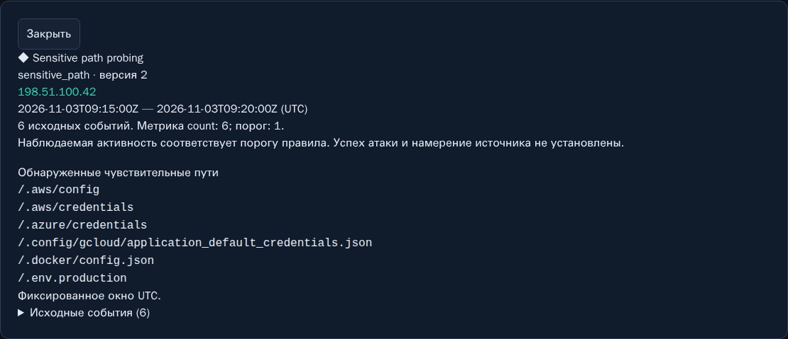
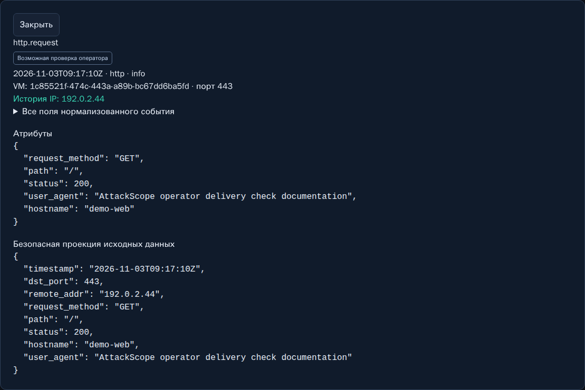

# 06. Классификация и смысл событий

[Вики](README.md) · [Назад: сводка](05-overview-history.md) · [Далее: расследования](07-investigations.md)

Этот раздел помогает отличить то, что записано в журнале, от предположения о
намерении и результате. AttackScope применяет небольшое число объяснимых
детерминированных правил; он не выполняет автоматическое подтверждение взлома.

## Событие, finding и severity

**Событие** — нормализованное свидетельство из источника.
**Finding** — срабатывание правила на одном или нескольких событиях.
**Severity** — уровень наблюдаемой активности, а не вероятность успешного взлома.

Штатные уровни модели: info, low, medium, high. В текущей реализации обычные
события получают info, SSH failure/invalid_user — low; совпадение правил
повышает соответствующие события до medium. High поддержан форматом, но
не является обычным результатом этих базовых правил.

У каждого finding доступны rule_id/name/version, окно времени, event_count,
метрика и порог, reason и evidence IDs. Показываются до 100 evidence IDs;
фактический count этим пределом не обрезается.

## Правила по умолчанию

Все правила группируют наблюдения по **host + source IP + source**.
Активность одного IP на двух VM не суммируется автоматически в одно окно правила.

| rule_id | Версия | Когда срабатывает |
|---|---:|---|
| ssh_bruteforce | 1 | Не менее 10 failure/invalid_user записей за фиксированные 300 s |
| web_rate | 1 | Не менее 120 HTTP-записей за фиксированные 60 s |
| web_paths | 1 | Не менее 30 разных HTTP paths за фиксированные 300 s |
| sensitive_path | 2 | Хотя бы одно обращение к известному чувствительному пути за 300 s |
| port_probing | 1 | Не менее 10 разных известных destination ports в firewall events за 300 s |

Пороги большинства правил настраиваются через ATTACKSCOPE_* при запуске backend.
Поля настроек и границы — [CLASSIFICATION.md](../CLASSIFICATION.md),
[.env.example](../../.env.example). В интерфейсе v0.1 нет редактора правил.

### Фиксированные окна

Окна выровнены по UTC, например 10:00–10:05 и 10:05–10:10.
Девять ошибок перед границей и девять после неё могут не дать порог 10
в каждом окне, хотя вместе их восемнадцать за короткое время.
Это известное ограничение fixed windows, не доказательство безвредности активности.

Поздно доставленная запись может пересчитать своё event-time окно. Findings
поэтому способны обновлять count и evidence при поздней доставке.

## Sensitive path v2



Правило включает исходные `.env`, `.git/config`, административные и диагностические
пути, а также добавленные cloud/container/config probes:

| Группа | Примеры точных путей |
|---|---|
| Dotenv | `/.env`, `/.env.local`, `/.env.production`, `/.env.development`, `/.env.bak` |
| Git / Bazaar | `/.git/config`, `/.bzr/branch/format` |
| AWS | `/.aws/config`, `/.aws/credentials` |
| Azure | `/.azure/credentials` |
| Google Cloud | `/.config/gcloud/application_default_credentials.json` |
| Docker | `/.docker/config.json`, `/.dockerenv` |
| Другие config/admin | `/.config`, `/config.json`, `/admin/config.php` |
| Web admin / diagnostics | `/wp-admin`, `/wp-login.php`, `/phpmyadmin`, `/server-status`, `/actuator/env` |

Полный действующий список — в
[classification/engine.py](../../backend/src/attackscope/classification/engine.py).
Сравнение case-insensitive и точное по нормализованному path. Query удаляется
до классификации. Подстроки `/docs/.aws/credentials` и `/.env.example` сами по
себе не совпадают с `/.aws/credentials` или `/.env`.

`reason.matched_paths` показывает до 20 наблюдавшихся разных путей. Если их
больше, UI сообщает об обрезке; event_count остаётся полным.
Статус 404 или 307 не выключает это правило: оно фиксирует интерес к пути,
а не успешность его получения.

### Как это происходит без терминала

Внешний клиент отправляет обычный запрос веб-серверу, например:

```http
GET /.env HTTP/1.1
Host: example.invalid
```

Клиенту не нужен SSH. Он проверяет, доступен ли известный путь через HTTP.
При ошибочной настройке веб-сервера файл может оказаться опубликованным.
Само появление запроса в access log не означает, что клиент получил файл
или доступ к файловой системе через терминал.

Название `.dockerenv` также может использоваться для определения окружения;
не каждое совпадение списка означает попытку украсть пароль именно из этого файла.

## SSH outcomes

| Значение | Что наблюдалось | Как проверять дальше |
|---|---|---|
| success | Успешная SSH-аутентификация | Ожидались ли IP, время, пользователь и способ входа? |
| failure | Ошибка аутентификации | Частота, повторяемость, соседние записи |
| invalid_user | Обращение к неизвестному пользователю | Серия usernames/IP и возможные сканеры |
| disconnect | Разрыв/закрытие соединения | Был ли рядом success/failure; сам по себе не brute-force |

Одна SSH-сессия способна породить несколько journal messages. Rule count —
число наблюдаемых failure/invalid_user записей, а не гарантированно число
уникальных сетевых соединений или введённых паролей.

Отсутствующий username не восстанавливается. В рабочей Vector-проекции могут
сохраняться только IP/порты/outcome/time, хотя parser допускает username.

## HTTP statuses и выводы

| Наблюдение | Допустимый вывод | Чего оно не подтверждает |
|---|---|---|
| `GET /missing-image.png → 404` | Ресурс не найден в ответе | Атака только по коду 404 |
| `GET /.env → 307` | Запрос чувствительного пути получил redirect | Выдача файла или безопасность всей VM |
| `GET /login → 200` | Страница ответила успешно на уровне HTTP | Успешный вход в приложение |
| Много разных URL | Перебор ресурсов / возможное scanning | Личность источника и успешная эксплуатация |
| Строка похожа на SQLi/XSS | В запросе есть подозрительная конструкция | Исполнение SQL или JavaScript на цели |

Для вывода об успешной эксплуатации нужны дополнительные свидетельства:
аудит приложения, изменения данных/файлов, события авторизации и другие
источники. Тело ответа и секреты AttackScope специально не сохраняет.

## Пометки операторских проверок



UI узнаёт ограниченный набор префиксов User-Agent: operator delivery check,
external delivery check, rotation check, recovery check и UI text check AttackScope.
Клиент может написать такой же User-Agent, поэтому пометка называется
**«Возможная проверка оператора»**.

Она не даёт bypass: запрос к `/.aws/credentials` с таким User-Agent всё равно
может получить sensitive_path и medium. Подсказка не уменьшает counters,
не скрывает запись и не является доверенной атрибуцией личности.

## Версии, история и доказательства

Версия правила входит в deterministic finding ID. Старые v1 findings сохраняются,
даже когда новая обработка использует sensitive_path v2. Глобальный backfill
старых событий автоматически не запускается. Не сравнивайте только число
findings до/после изменения правила как независимую оценку роста атак.

При расследовании фиксируйте версию, порог, окно и период. Если evidence истекло
по retention, укажите это в выводе. Отсутствие finding также не является
доказательством отсутствия подозрительной активности: могли не достичь порога,
попасть на границу окна или не попасть в доступные журналы.

**Далее:** [07. Пошаговые расследования](07-investigations.md).
