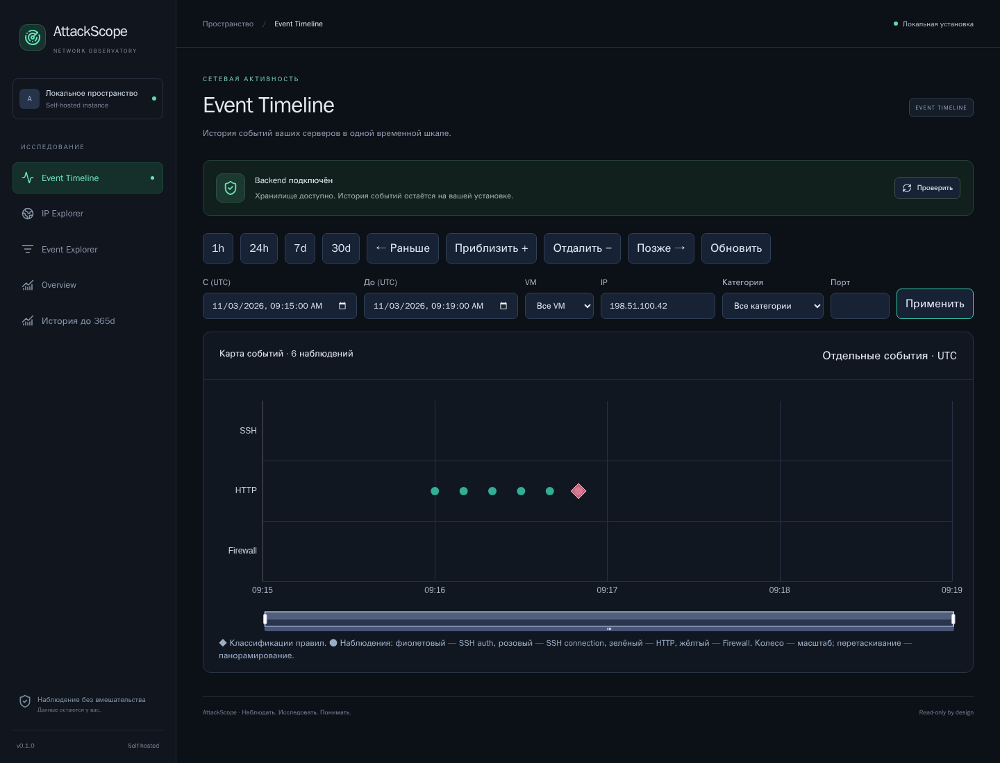

# 07. Пошаговые расследования

[Вики](README.md) · [Назад: классификация](06-detection.md) · [Далее: эксплуатация](08-operations.md)

Сценарии обучают исследованию сохранённых наблюдений. Они не запускают атаки,
не меняют SSH/firewall и не предлагают выполнять команды из журналов.
Для точного повторения изображений используйте отдельный
[учебный стенд](11-screenshots.md) на localhost:18182.

## Сценарий A. Найти всплеск HTTP и понять его причину

**Вопрос:** один источник создал много запросов или активность распределена?

1. Откройте Timeline → 24h → VM `demo-wiki`.
2. Найдите крупную зелёную группу; наведите курсор и прочитайте count/интервал.
3. Нажмите группу → **«Исследовать интервал»**.
4. Если она остаётся плотной, добавьте IP `198.51.100.77`.
5. Откройте ромб `Web scanning: request frequency`, запишите порог и окно.
6. Из карточки или Event Explorer перейдите к истории IP.
7. Сравните число URL, статусы и временную концентрацию.
8. Откройте таблицу событий этого IP, уточните период и выгрузите JSON.

В наборе investigation этот IP создаёт 1800 синтетических HTTP-записей.
Большой count сам по себе не доказывает DDoS: AttackScope не измеряет весь
поток пакетов, полосу сети или системную нагрузку.

**Пример вывода:** «В выбранном окне наблюдалась высокая частота HTTP-запросов
одного source IP; выполнен порог web_rate. Причина и исходные записи доступны;
последствия для приложения по этим access logs не установлены».

## Сценарий B. Проверить поиск cloud credentials

**Вопрос:** источник действительно перебирает известные конфигурационные пути?

1. На Timeline выберите 24h и IP `198.51.100.42`.
2. Примените фильтры: на карте останутся шесть отдельных HTTP-наблюдений.
   Приблизьте интервал вокруг серии запросов, чтобы различить соседние точки.
3. Откройте Event Explorer, задайте тот же IP и source=http.
4. Откройте несколько строк, сравните `path`, `status` и `user_agent`.
5. Нажмите **«История IP»** и проверьте таблицы URL/HTTP status.
6. В **«Сработавшие правила»** откройте `Sensitive path probing`.
7. Убедитесь, что версия 2, event_count=6 и matched_paths соответствуют наблюдениям.
8. Раскройте evidence IDs и, при необходимости, откройте исходные события.



**Факты:** шесть известных конфигурационных путей, ответы 307/404, один IP,
одно окно классификации.

**Обоснованное предположение:** последовательность похожа на автоматический
поиск случайно опубликованных credentials и конфигураций.

**Не подтверждено:** что credentials существовали, были возвращены в ответе
или использованы; кто управлял IP; был ли скомпрометирован сервер.

## Сценарий C. Разобрать SSH-подбор

В учебном investigation источником SSH-ошибок является `203.0.113.42`.

1. Выберите этот IP и категорию `ssh_authentication` на Timeline.
2. Откройте SSH finding, посмотрите count, threshold и fixed UTC window.
3. Откройте IP Explorer и таблицу **SSH outcomes**.
4. Проверьте, есть ли success в том же выбранном диапазоне.
5. Перейдите в Event Explorer с source=ssh и порядком **«Сначала старые»**.
6. Сопоставьте ошибки, invalid_user, disconnect и возможный success по времени.

Если появился success, его ожидаемость следует сверять с оператором и SSH audit:
адрес, username, время, способ входа и ключ. AttackScope не может определить,
кому принадлежал использованный ключ, только по IP.

Для сравнения в demo есть штатный success/disconnect от `192.0.2.50`.
Наличие этого success не означает, что SSH-подбор с другого IP завершился входом.

**Пример вывода:** «Зафиксирована серия failure/invalid_user, сработал
ssh_bruteforce. В выбранных сохранённых событиях success от этого IP не найден;
полная проверка компрометации этим не исчерпывается».

## Сценарий D. Разобрать обращения к разным портам

1. На учебном стенде выберите IPv6 `2001:db8::bad`.
2. Посмотрите Firewall-дорожку и finding `Observed port probing`.
3. В IP Explorer откройте распределение целевых портов.
4. В карточках сравните protocol и action, когда они известны.
5. Укажите в выводе, что это только логируемые firewall observations.

Нельзя заключить, что все эти порты открыты или что виден весь port scan.
DROP в журнале говорит о записанном действии для наблюдаемого пакета,
а пустая дорожка без включённого логирования не опровергает scanning.

На рабочей VM firewall collection сейчас может отсутствовать; изображённые
firewall records относятся исключительно к demo.

## Сценарий E. Отделить приёмочную проверку от неизвестного запроса

1. Откройте Event Explorer с IP `192.0.2.44` на учебном стенде.
2. Откройте строку с пометкой **«Возможная проверка оператора»**.
3. Прочитайте title пометки и User-Agent в атрибутах.
4. Сверьте время и цель запроса с журналом собственных приёмочных работ.
5. В отчёте укажите способ атрибуции: совпадение с вашей проверкой,
   а не только доверие произвольному User-Agent.

Если запрос подозрительный, пометка не должна останавливать анализ.
Подделка User-Agent не удаляет classification и не делает IP доверенным.

## Сценарий F. Обычный 404

1. В Event Explorer найдите IP обычной фоновой активности, например `192.0.2.1`.
2. Сравните несколько путей и ответы; в наборе есть отсутствующие изображения.
3. Проверьте, достигнуты ли rate/path thresholds и есть ли sensitive paths.
4. Не называйте каждую строку 404 отдельной атакой.

Один broken link и последовательность запросов к credentials — разные основания
для оценки, даже если часть HTTP statuses совпадает.

## Шаблон заметки по расследованию

```text
Период (UTC):
Установка / VM:
Source IP и источник журнала:
Фильтры:

Наблюдаемые факты:
- количество записей, timestamps, пути/порты/outcomes;
- коды ответов и доступные атрибуты.

Сработавшие правила:
- rule_id, версия, окно, observed/threshold, evidence.

Интерпретация:
- почему поведение подозрительно;
- какие записи относятся к подтверждённым собственным проверкам.

Не установлено / ограничения:
- охват логирования, retention, отсутствие ответа/body, missing fields.

Приложения:
- обезличенная выгрузка, период и фильтры, нужные screenshots.
```

Не включайте в публичную заметку реальные tokens, полную БД или неочищенные
журналы. Экспортированные IP и пути также требуют оценки перед публикацией.

**Далее:** [08. Установка и эксплуатация](08-operations.md).
