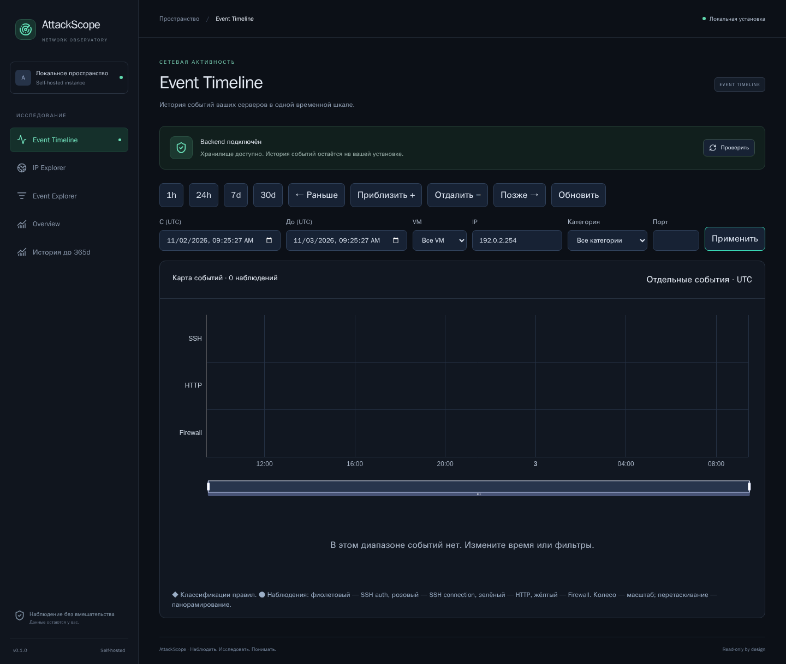
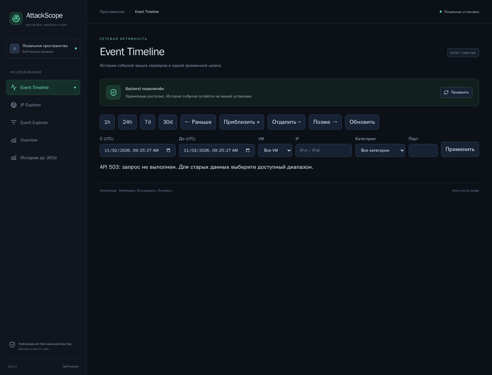

# 09. Диагностика проблем

[Вики](README.md) · [Назад: эксплуатация](08-operations.md) · [Далее: справочник](10-reference.md)

Сначала установите, какой экземпляр открыт и есть ли ошибка запроса. Нулевой
результат, недоступность API и отсутствие доставки — разные ситуации.

## Быстрый порядок проверки

1. Адрес: 8180 — обычный локальный, 18180 — VM через туннель, 18182 — docs-demo.
2. Работает ли соответствующий процесс/Compose-проект/SSH-туннель?
3. Что показывает состояние backend?
4. Нет ли alert с HTTP status?
5. Диапазон UTC и фильтры действительно включают нужное событие?
6. Источник подключён, читает поддержанный формат и доставляет записи?

Сохраняйте существующую БД. Удаление данных не исправляет неверный адрес,
фильтр, формат журнала или недоступный socket.

## Не открывается приложение / Access Error: 404

Проверьте адрес и `docker compose ps` в нужном проекте. Внутренний порт Nginx
8080 не обязательно опубликован на host как 8080. На этом проекте обычный UI
открывается через 8180; на других портах может отвечать другое приложение.

Для VM убедитесь, что SSH-туннель активен и ведёт на правильный Unix socket.
Отказ соединения с localhost:18180 сам по себе не означает отказ backend на VM.
Туннель и локальная вкладка — дополнительные звенья доступа.

## Backend недоступен

1. Нажмите **«Проверить»** в статусе подключения.
2. Посмотрите состояния контейнеров своего проекта.
3. Проверьте последние backend logs приватно.
4. Проверьте место, владельца каталога данных, OOM/memory limit и ошибку миграции.
5. Если frontend недавно обновлялся, обновите вкладку с обходом cache.

Надпись «Backend подключён» означает readiness read API. Она не гарантирует,
что каждый подключённый source исправно доставляет события.

## Пустая Timeline

Проверьте:

- Выбрана ли нужная VM?
- Правильно ли введён IP и не остался ли destination port?
- Есть ли нужный category/source на этой VM?
- Выбраны ли UTC, а не локальные часы?
- Входит ли время подключения collector в период?
- Не истекло ли detail retention?
- Не используется ли старое `--run-name` demo со старым базовым временем?

Очистите фильтры и попробуйте 24h/7d. Для свежего локального demo можно выбрать
новое run-name. Не добавляйте demo-записи в production, чтобы искусственно
сделать карту непустой.

## Ошибка API в рабочем интерфейсе

*На этом изображении HTTP503 намеренно подставлен только в браузере при съёмке.
Показан настоящий error UI; это не зафиксированный сбой рабочей VM.*

Readiness может оставаться зелёным, когда конкретный тяжёлый запрос завершается
503. Уменьшите период, добавьте IP/VM и повторите. Пустой результат без alert
и неуспешный запрос с alert следует трактовать по-разному.

| Status | Типичная причина | Действие |
|---|---|---|
| 401 ingestion | Нет действующего source token | Проверить источник и секрет приватно |
| 403 ingestion | Не тот host/kind или запрещённый источник | Сверить привязку source; не подменять host ID |
| 408 | Истёк timeout тела запроса | Проверить доставку и ограничения batch |
| 410 | Истёк detail/cursor/history | Обновить страницы или открыть агрегатную историю |
| 413 | Слишком большой body/export | Разбить batch или сузить выгрузку |
| 415 | Неподдержанный формат/encoding | Сверить контракт ingestion |
| 422 | Неверный IP, timestamp, поле или диапазон | Исправить ввод; сверить UTC и schema |
| 429 | Rate/concurrency limit | Повторить с паузой, проверить burst и частоту |
| 503 | Временно занята запись/query deadline/другая временная ошибка | Сузить запрос, проверить ресурсы и повторить |

Для ingestion 4xx формата/прав доступа требуют исправления, а не бесконечного
повтора того же неподдержанного batch. Временные ошибки агент повторяет с паузой.

## Не появляются новые события

Проверьте цепочку в порядке: **исходный журнал → Vector source → transform →
sink/auth → backend → выбранные фильтры**.

Возможные причины:

1. Журнал не пишет интересующий тип события.
2. Нет прав чтения journal/file или указан неверный путь/unit.
3. Первая подписка настроена since_now и не импортирует старые записи.
4. Формат не поддержан, transform отбрасывает запись.
5. В sink не подставился секрет или неверен ingestion URL.
6. Backend временно недоступен, записи ожидают в buffer.
7. Наблюдение принято, но его timestamp находится вне открытого периода.

Не выводите source tokens при проверке. Для существующих env-based Vector
примеров учитывайте специальный флаг подстановки версии Vector; production
использует file secrets. Это разные варианты конфигурации.

## События есть, findings нет

- Подождите фоновую обработку.
- Проверьте фактический threshold и окно.
- Учтите разбиение по host/IP/source.
- Проверьте границу фиксированных UTC окон.
- Убедитесь, что путь точно входит в список правила.
- Учтите версию backend: новые sensitive paths появились в v2 правила.
- Старые обработанные записи не получают новую классификацию массово автоматически.

Отсутствие finding не отменяет наблюдаемую последовательность. Можно провести
ручной разбор по Event Explorer, не объявляя это доказанным успешным инцидентом.

## Не работает экспорт / появилась не вся таблица

Экспорт не ограничивается текущей страницей. При 413 уменьшите диапазон так,
чтобы весь результат помещался в 10 000 событий / 8 MiB. При cursor error
сначала обновите таблицу. Убедитесь, что браузер разрешил сохранение файла.

Отсутствующий URL в списке IP Explorer может быть следствием top 100 или null,
а отсутствие строки в detail после 30 дней — retention. См. [историю](05-overview-history.md).

## Кажется, что масштаб всё ещё обновляет страницу

1. Один раз обновите вкладку после deployment: старые JS assets могут оставаться
   в уже открытом SPA.
2. Проверьте версию frontend, а не только backend.
3. Отличайте индикатор фонового запроса от перезагрузки всего документа.
4. Если проблема повторяется, сохраните шаги: кнопка/колесо/slider, фильтры,
   период, browser version и наличие alert.

В текущем frontend canvas сохраняется при смене диапазона и пустом результате;
проверка с задержкой API включена в browser regression.

## GeoIP/ASN недоступны, Firewall пуст

GeoIP unavailable без provider — ожидаемое состояние. Пустая Firewall-дорожка
при отсутствии logging/collector тоже ожидаема. Не добавляйте вымышленные
значения или правила firewall ради внешне полной страницы.

## Что приложить к описанию проблемы

- Версию кода/images и тип установки.
- Период UTC, screen, фильтры и последовательность действий.
- Status/error code и request ID, если доступен.
- Обезличенный скриншот и минимальный безопасный пример формата события.
- Состояние контейнеров без tokens/environment dump.

Не прикладывайте `.env`, source files с секретами, полную рабочую БД,
Authorization/Cookie или необработанные реальные журналы.

**Далее:** [10. Поля, термины и ограничения](10-reference.md).
